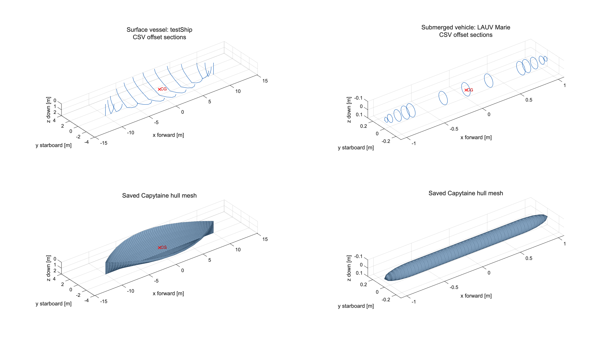
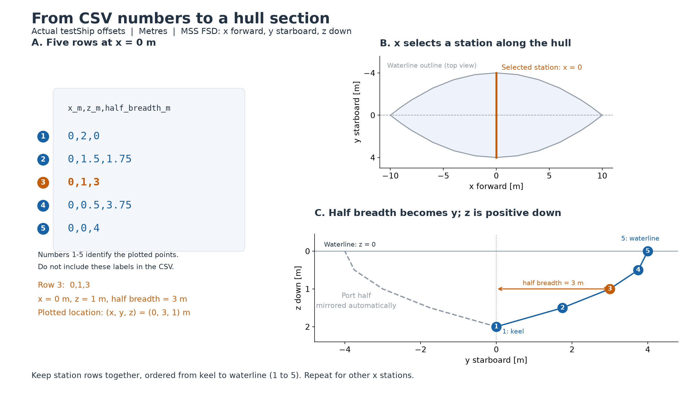

# How to Build Your Own Marine Craft Simulator

The default MSS workflow uses the open-source Capytaine solver.
[MSS-Capytaine](https://github.com/cybergalactic/MSS-Capytaine) computes
hydrodynamic data from your hull geometry and exports a vessel MAT-file.
MSS uses that file to simulate the craft in MATLAB or GNU Octave.



*Test ship and LAUV Marie hull sections and meshes from [MSS-Capytaine](https://github.com/cybergalactic/MSS-Capytaine).*

## 1. Try a bundled vessel

After [installing MSS](GETTING-STARTED.md#1-install-mss), run:

```matlab
SIMhydroVessel
```

In the **Hydrodynamic Model Test Tool**, choose **Test ship** under
**Capytaine**, then click **Run simulation**. The bundled `testShip.mat`
uses a synthetic hull and lets you try the simulator before installing
Python or generating a mesh.

## 2. Prepare your hull and vessel properties

Install [MSS-Capytaine](https://github.com/cybergalactic/MSS-Capytaine#requirements)
separately. Start with its [vessel configuration guide](https://github.com/cybergalactic/MSS-Capytaine/blob/main/How%20to%20configure%20the%20vessel%20JSON%20file.md)
and copy a case that matches your craft. Use the `testShip_csv` case for a
surface monohull or `LAUV_marie_csv` for a submerged vehicle.

Put your geometry and `config.json` together in a case folder such as
`vessels_capytaine/myVessel_csv/`. Use **CSV hull offsets** if you have
hull sections and need MSS-Capytaine to generate the panels. Existing
STL or GDF meshes and MGF hull sections are also supported.



*How the Test ship CSV defines one hull section.*

Set `geometry_file`, `body_name`, and `output_filename` to match your
case. Enter the mass, center of gravity (CG), and inertia properties for
the same loading condition as the hull geometry. Check the waterline for a
surface craft or the submergence depth for an underwater vehicle. Use metres
and MSS forward–starboard–down axes for CSV coordinates, STL vertices, and
reference points in the JSON. Set the frequency grid, mesh resolution, and
viscous damping inputs for your vessel.

## 3. Generate and check the vessel MAT-file

From the MSS-Capytaine repository root, run:

```sh
python main.py myVessel_csv
```

With `output_filename` set to `myVessel.mat`, the exporter writes
`vessels_capytaine/myVessel_csv/myVessel.mat` beside `config.json`.
The file contains the MSS `vessel` structure with rigid-body properties,
added mass, radiation damping, hydrostatic restoring, and wave-response data.
The hydrodynamic coefficients are computed at zero forward speed and
exported about the CG.

Add the MSS-Capytaine `matlab/` folder to the MATLAB or GNU Octave path
and use its viewers:

```matlab
plotVesselGeometry('myVessel')
plotVesselHydrodynamics('myVessel')
```

Check the hull shape, waterline or submergence, CG location, and solver
warnings. Refine the mesh and compare coefficients and response amplitude
operators (RAOs) over the frequency range of interest before using the
results. If you edit only the saved damping inputs, use
`python main.py myVessel_csv --update-damping` to refresh the MAT-file.

## 4. Run your vessel in MSS

1. Run `SIMhydroVessel` and choose **Load vessel MAT-file...**. Open
   `myVessel.mat` directly from your case folder.
2. Review the imported viscous damping, choose **Heading autopilot** or
   **Dynamic positioning**, and set the initial state, current, and wave
   conditions. For a heading-controlled transit run, set the **Constant surge
   force (N)** for your craft. The generic default is zero.
3. Click **Run simulation**. Compare the position or heading response with
   the commanded values, then inspect the wave loads and vessel motion.

MSS computes constant maneuvering matrices from the frequency-dependent
added mass and radiation damping using the power-based method. The
MAT-file also supplies the wave-force RAOs and, when available, mean-drift
coefficients used in the simulation.

## 5. Customize and validate the simulator

Use [`SIMhydroVessel.m`](../CRAFT/SIMhydroVessel.m) as a template for
your simulation loop and [`hydroVessel.m`](../CRAFT/hydroVessel.m) for the
6-DOF equations of motion. Keep the hull data and the control inputs in the
same reference frame. Add vessel-specific propulsion, actuator limits,
nonlinear drag, or control-surface forces as needed. The
[Otter USV](../CRAFT/USV/models/otter.m) and
[LAUV Marie](../CRAFT/AUV/models/lauvMarie.m) models show how to extend the
baseline for different craft.

Calibrate the added terms using available free-decay tests, maneuvering
trials, or other measurements, and assess the model against separate data
over the intended operating range.

For existing WAMIT solver results, see the
[WAMIT configuration and import guide](../HYDRO/vessels_wamit/WAMIT-Configuration.md).
