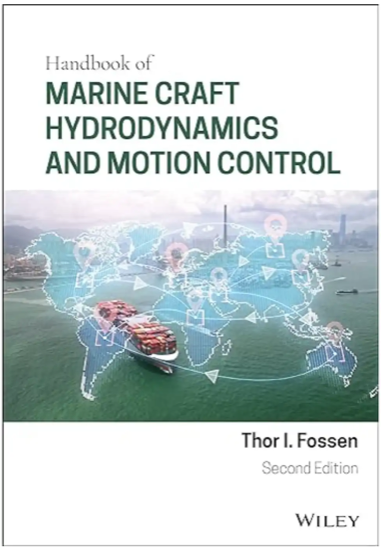

# Handbook of Marine Craft Hydrodynamics and Motion Control

> The third edition is in preparation for publication by Wiley in 2027.

**Thor I. Fossen**

Second edition · John Wiley & Sons · April 2021 · 736 pages  
Hardcover ISBN 978-1-119-57505-4

The handbook connects marine craft hydrodynamics with guidance, navigation,
and control (GNC). It shows how to build mathematical models and use them
to design and test motion control systems for ships, offshore structures,
autonomous underwater vehicles (AUVs), and uncrewed surface vehicles (USVs).

- **Marine craft hydrodynamics.** Kinematics, rigid-body dynamics, hydrostatics,
  seakeeping, maneuvering, and environmental loads.
- **Motion control systems.** Guidance and path following, state estimation,
  heading and course control, dynamic positioning, and control allocation.

## Lecture notes and companion software

Download chapter slides and check the edition listed for each chapter on the
[handbook lecture notes page](https://wiley.fossen.biz/).

Use MSS to explore the models and algorithms through runnable MATLAB and
GNU Octave examples. Follow [Getting Started with MSS](GETTING-STARTED.md)
and browse the [textbook examples](../MSS%20Quick%20Reference.md#mss-examples-m-files).

The publisher provides the table of contents and a sample chapter on the
[Wiley book page](https://www.wiley.com/en-no/handbook-of-marine-craft-hydrodynamics-and-motion-control-2nd-edition-p-9781119575054).
