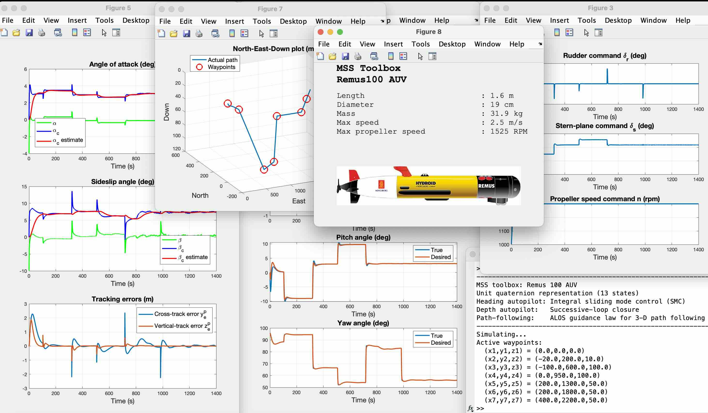

# MSS (Marine Systems Simulator)

The Marine Systems Simulator (MSS) is a MATLAB library (www.mathworks.com) for designing and testing marine control systems. The m-files are compatible with the free software GNU Octave (www.octave.org). MSS includes models for ships, underwater vehicles, uncrewed surface vehicles, and floating structures. The library also contains guidance, navigation, and control (GNC) functions for time-domain simulation.

**License and use.** You may use, copy, modify, distribute and sell the code, including for commercial applications, under the [MIT License](LICENSE). Retain the copyright and license notices in copies or substantial portions of the code.

**Use at your own risk.** This software is supplied without warranty or guarantee of accuracy, reliability, safety or fitness for a particular purpose. Users are responsible for validating results and ensuring safe application. To the extent permitted by law, the author and contributors accept no liability for accidents, personal injury, property damage or other loss arising from its use. See the [MIT license](LICENSE).

### Release 2.0

This release substantially expands the CRAFT library with new vessel models and a unified workflow for building 6-DOF vessel models from WAMIT and Capytaine seakeeping data. The new [`hydroVessel.m`](CRAFT/hydroVessel.m) function implements the 12-state, 6-DOF equations of motion, while the editable [`SIMhydroVessel.m`](CRAFT/SIMhydroVessel.m) simulator provides a reusable template for building a user-defined surface vessel, USV, AUV, or ship.

`SIMhydroVessel.m` includes a hydrodynamic model test GUI. Load an MSS-Capytaine vessel MAT-file directly from `vessels_capytaine/<vessel>_<format>/`, or select a bundled Capytaine or WAMIT vessel. It supports irregular seas with selectable wave spectra and directional spreading, first-order wave forces computed from force RAOs, ocean currents, and either heading-autopilot or dynamic-positioning (DP) control.

The new [`otter.m`](CRAFT/USV/models/otter.m) provides a unified 6-DOF maneuvering and seakeeping model of the Otter USV using MSS-Capytaine power-based added mass, radiation damping, and hydrostatic restoring, augmented with nonlinear Coriolis/centripetal terms, damping, twin-pontoon cross-flow drag, payload dynamics, and propeller thrust. [`SIMotter.m`](CRAFT/USV/SIMotter.m) includes heading control, ALOS/ILOS path following, and an integrated setup GUI for currents, waves, simulation duration, and time step. First-order Capytaine wave loads can be enabled with either the new model or the previous first-principles [`otter_legacy.m`](CRAFT/USV/models/otter_legacy.m), selected by a GUI checkbox. The new model is the default; waves are initially disabled. Wave-force, spectrum, and wave-elevation plots are included.

The CRAFT library also includes the dedicated [`lauvMarie.m`](CRAFT/AUV/models/lauvMarie.m) and [`SIMlauvMarie.m`](CRAFT/AUV/SIMlauvMarie.m) pair. This is a standalone, wave-enabled model of the 2.15 m LAUV Marie at NTNU, rather than another configuration of the generic `hydroVessel` model. It combines MSS-Capytaine hydrodynamic data with a unified power-based seakeeping/maneuvering formulation, calibratable viscous and friction terms, and additional nonlinear hydrodynamic terms. Its simulation supports ocean currents, directional JONSWAP waves with depth-attenuated first-order wave loads, depth/heading control, and ALOS guidance for 3-D path following.

The force- and motion-RAO functions accumulate signed encounter phase during changes in speed and heading, consistent with Chapter 10 of Fossen (2027). Custom simulation loops should retain the updated `waveModel` output at each call; see the [wave-function interfaces](LIBRARY/General-Library.md#wave-simulation). The supplied simulations and examples use this convention. Craft images are organized under `CRAFT/<type>/models/figs`, with the existing Simulink copies retained.

This release aligns with [MSS-Capytaine 1.2](https://github.com/cybergalactic/MSS-Capytaine/blob/main/CHANGELOG.md). Capytaine supply-vessel and S175 datasets replace the former ShipX catalogue, and the ShipX importer has been removed. The speed-dependent S175 dataset used by the 2025 power-based averaging example is retained separately in [`mssExamples/data`](mssExamples/data/README.md). WAMIT import remains available. The open-source MSS-Capytaine add-on provides a workflow for generating hydrodynamic vessel models without commercial seakeeping software.

Power-based averaging now uses a common JONSWAP reference with peak frequency `omega_p = 1.0` rad/s and `gamma = 3.3`. The [`exManeuveringModel`](mssExamples/exManeuveringModel.m) comparison uses this same wave baseline and identical additive viscous damping in both methods, with a 300 s default duration to show the response after startup transients.

Legacy Simulink vessel templates have been removed. The Simulink library and demonstration models remain included.

Hydrodynamic modeling and the GNC algorithms are described in:

    T. I. Fossen (2027). Handbook of Marine Craft Hydrodynamics and Motion Control. 3rd Edition, Wiley (in progress).

The lecture notes https://wiley.fossen.biz serve as documentation for the toolbox.

### Recommended citation

When using this release, please cite the software as:

> Fossen, Thor I. (2026). *Marine Systems Simulator (MSS)* [Computer software]. GitHub. https://github.com/cybergalactic/MSS

```bibtex
@software{Fossen2026_MSS,
  author  = {Fossen, Thor I.},
  title   = {Marine Systems Simulator (MSS)},
  year    = {2026},
  url     = {https://github.com/cybergalactic/MSS}
}
```

For the original MSS development and historical background, use:

    T. I. Fossen and T. Perez (2004). Marine Systems Simulator (MSS)
    URL: https://github.com/cybergalactic/MSS

### Installation

- [How to install MSS for MATLAB](How%20to%20install%20MSS%20for%20MATLAB.md)  
  You can update an existing path automatically and remove dead links using the command 'mssPath'.
- [How to install MSS for GNU Octave](How%20to%20install%20MSS%20for%20GNU%20Octave.md)  
  To update an existing path and remove dead links, the old path in the startup file (https://docs.octave.org/latest/Startup-Files.html) must be deleted before a new path with subfolders is saved under GNU Octave.

### Get Started

To get started and find help on using the MSS, type the following command in the MATLAB command window:

    mssHelp

Craft models and editable time-domain simulation scripts are located under the catalog:

    /MSS/CRAFT/                            Craft model library and scripts for time-domain simulation

See the [CRAFT Library documentation](CRAFT/CRAFT-Library.md) for the available models, simulation scripts, and hydrodynamic-vessel workflow.


Figure 1. The user-editable script 'SIMremus100.m' is used to simulate the Remus 100 AUV ('remus100.m') during 3-D path following.

Examples and demo files are located under the catalogs: 

    /MSS/mssExamples/                       Textbook m-file examples (Fossen 2027)
    /MSS/mssDemos/                          MSS m-file demos
    /MSS/SIMULINK/mssSimulinkDemos/         Simulink demos

## GNC Library

The GNC library contains reusable functions for marine guidance, navigation, and feedback control, including:

- Two- and three-dimensional path-following guidance using line-of-sight (LOS), integral LOS (ILOS), and adaptive LOS (ALOS) methods.
- Straight-line waypoint paths, Hermite splines, hybrid paths, cross-track errors, and path-projection utilities.
- Navigation and attitude calculations, including a five-state GNSS extended Kalman filter and static roll, pitch, and yaw estimation from IMU measurements.
- Nonlinear MIMO PID control for dynamic positioning, integral sliding-mode heading control, and linear-quadratic tracking.
- Control allocation, command and reference models, LOS command filtering, and saturation utilities.

See the [GNC Library documentation](GNC/GNC-Library.md) for a categorized function overview.

## INS Library

The INS library contains user-editable functions and simulation examples for inertial navigation and attitude estimation, including:

- Aided error-state Kalman filters (ESKFs) using Euler-angle or unit-quaternion attitude representations.
- Multiplicative extended Kalman filters (MEKFs) for quaternion attitude and aided INS estimation.
- A nonlinear Mahony–Hamel–Pflimlin (MHP) quaternion attitude observer with angular-rate sensor bias estimation.
- Position-, velocity-, compass-, magnetometer-, AHRS-, and pressure-aided navigation examples, including heave estimation.
- IMU test-signal generation and gravity and magnetic-field reference models.

See the [INS Library documentation](INS/INS-Library.md) for the available simulations and supporting functions.

## HYDRO Library

The toolbox reads output files generated by seakeeping programs and processes the data for use in MATLAB or GNU Octave. MSS Hydrodynamics includes several example vessels and supports data from:

- WAMIT, a commercial 3D potential-flow program by WAMIT Inc.
- [Capytaine](https://capytaine.org/), an open-source 3D potential-flow boundary-element solver, through the [MSS-Capytaine](https://github.com/cybergalactic/MSS-Capytaine) Python add-on

WAMIT requires a commercial license. Capytaine is free and open source and is installed separately as a Python dependency of MSS-Capytaine. All eight current MSS-Capytaine vessel MAT-files are included. Pre-generated cases for the [supply vessel](HYDRO/vessels_capytaine/supply/Supply.md), [S175](HYDRO/vessels_capytaine/S175/S175.md), synthetic [testShip](HYDRO/vessels_capytaine/testShip/Test-Ship.md), submerged [LAUV_marie](HYDRO/vessels_capytaine/LAUV_marie/LAUV-Marie.md), and [Otter USV](HYDRO/vessels_capytaine/Capytaine-Vessels.md#otter-usv) are included and can be used directly in MATLAB or GNU Octave without installing Python.

The processed data use the common MSS `vessel` structure. The editable [SIMhydroVessel.m](CRAFT/SIMhydroVessel.m) script uses this structure for time-domain simulation of 6-DOF maneuvering, control, ocean currents, and first-order wave loads. All Capytaine and WAMIT catalogue files take their default viscous-damping inputs from `vessel.powerBased`. Capytaine inputs come from the MSS-Capytaine JSON configurations; `wamit2vessel` collects the WAMIT inputs with editable defaults. Simulation-specific overrides can be set in `hydroVesselConfig.m`.

For LAUV Marie, the standalone [lauvMarie.m](CRAFT/AUV/models/lauvMarie.m) model and [SIMlauvMarie.m](CRAFT/AUV/SIMlauvMarie.m) simulation add the vehicle-specific nonlinear, calibration, control, guidance, and wave-depth features. The `SIMhydroVessel` GUI initially loads `LAUV_marie.mat` for a generic hydrodynamic test; use **Load vessel MAT-file** to select another exported model. Only the vessel MAT-file is needed; geometry verification stays in MSS-Capytaine. The dedicated LAUV simulation is `SIMlauvMarie`.

Example data and processing instructions are organized by source:

Run `mssCraft` in the MATLAB or GNU Octave Command Window to display two lists: hydrodynamic vessel MAT-files, with their solver and location, and all CRAFT dynamics models, with their simulation scripts and location. The command only displays the lists; it does not return data or change workspace variables. Companion `*ABC.mat` files and the example-only legacy S175 dataset are omitted from the hydrodynamic catalogue.

- [WAMIT vessel data](HYDRO/vessels_wamit/WAMIT-Vessels.md)
- [Capytaine vessel data](HYDRO/vessels_capytaine/Capytaine-Vessels.md)

See the [HYDRO Library documentation](HYDRO/HYDRO-Library.md) for the complete data-processing and simulation workflow.

## FDI Toolbox

This is a stand-alone toolbox for identifying radiation-force models and fluid-memory effects of marine structures such as marine craft and wave energy converters. Please include the following reference when you use the MSS FDI toolbox:
 
    T. Perez and T. I. Fossen (2009). A Matlab Tool for Parametric Identification of Radiation-Force Models of Ships and Offshore Structures. 
    Modeling, Identification and Control, MIC-30(1):1-15. DOI: https://doi.org/10.4173/mic.2009.1.1 

See the [FDI Toolbox documentation](FDI/FDI-Toolbox.md) for demonstrations, functions, and documentation.

## General Library

The [MSS General Library documentation](LIBRARY/General-Library.md) describes the reusable modeling, kinematics, environmental, maneuvering, numerical, filtering, and motion-sickness functions.
